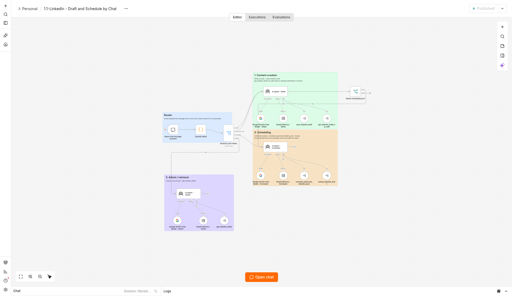

# LinkedIn draft, schedule, and publish

Chat and a small web page draft LinkedIn posts, save them for approval, schedule a future time, and publish due posts from an n8n Data Table named `linkedin_posts`.

The chat workflow is **1.1-LinkedIn - Draft and Schedule by Chat**. A router classifies each message and sends it to a writer, a scheduler, or an admin agent. All three agents use Google Gemini (`models/gemini-3.5-flash-lite`) and call the tool workflows below. Nothing in 1.1 posts to LinkedIn. Publishing is a separate schedule in workflow 03.



## Workflows

| File | Source id | Role |
| --- | --- | --- |
| [workflows/1.1-LinkedIn-Draft-and-Schedule-by-Chat.json](workflows/1.1-LinkedIn-Draft-and-Schedule-by-Chat.json) | `828YGbeJbkLIePsU` | Main chat. Writer, scheduler, and admin agents. |
| [workflows/02-LinkedIn-Save-Approved-Post.json](workflows/02-LinkedIn-Save-Approved-Post.json) | `2Iu9U6IT4LBvmw7Q` | Tool. Approve, schedule, or reschedule an existing draft. |
| [workflows/03-LinkedIn-Publish-Due-Posts.json](workflows/03-LinkedIn-Publish-Due-Posts.json) | `h50V7calMoUp7qTU` | Publisher. Posts rows whose `scheduled_at` is due. |
| [workflows/04-Save-LinkedIn-Draft.json](workflows/04-Save-LinkedIn-Draft.json) | `Ol3JmkV6ymQDonAo` | Tool. Insert or update a `pending_approval` draft. |
| [workflows/05-Get-LinkedIn-Drafts.json](workflows/05-Get-LinkedIn-Drafts.json) | `gCYO2TW5surSyWqf` | Tool. Read drafts by `session_id` or `draft_id`. |
| [workflows/06-LinkedIn-Error-Alerts.json](workflows/06-LinkedIn-Error-Alerts.json) | `jl9nHJh3vrqdo429` | Error workflow. Emails unexpected workflow errors. |
| [workflows/07-LinkedIn-Overdue-Post-Watchdog.json](workflows/07-LinkedIn-Overdue-Post-Watchdog.json) | `lVDGrjGnB80WUjN3` | Every 15 minutes, emails a digest of overdue, stuck, or failed rows. |
| [workflows/08-LinkedIn-Web-UI.json](workflows/08-LinkedIn-Web-UI.json) | `IbNAwNphCRxEbBHO` | Web UI on webhook path `linkedin-posts`. |

## Architecture

```text
Chat (1.1)                         Web UI (08)  /webhook/linkedin-posts
  writer  --> 04 save draft          generate (Gemini) --> 04 save draft
  writer  --> 05 get drafts          save edits            --> 04 save draft
  scheduler --> 02 approve/schedule  schedule / reschedule --> 02 approve/schedule
  scheduler --> 05 get drafts        queue, reopen failed, delete --> linkedin_posts
  admin   --> 05 get drafts
                    \                      /
                     v                    v
                    linkedin_posts
                           |
                           v
              03 every 30 minutes: due scheduled rows
                 --> LinkedIn create post
                           |
           06 emails on workflow errors
           07 emails overdue / stuck publishing / failed rows
```

- **04** saves draft text with status `pending_approval` and a `session_id`. If that session already has a pending draft, or the caller passes a `draft_id`, it updates that row.
- **02** updates an existing row to `scheduled` after explicit approval, or changes `scheduled_at` on a row that is already `scheduled`. It requires a real draft id and an ISO 8601 time with a timezone offset. It refuses past times and already published rows.
- **05** returns saved rows for the writer, scheduler, and admin agents.
- **03** is the only workflow that calls LinkedIn. Its trigger node is named `Every minute`; the interval in the export is every 30 minutes. It loads `scheduled` rows, keeps those with `scheduled_at` in the past, marks them `publishing`, creates the post, then marks them `published` (and sets `published_at`) or `failed`.
- **08** serves the review page and posts form actions back to the same webhook. Generate uses Gemini, then 04. Schedule uses 02.
- **06** is the error workflow. In the source instance it is attached on 1.1, 02, 03, 04, and 05. It skips expected validation errors and emails the rest.
- **07** scans the table every 15 minutes and emails when it finds a scheduled row past its time, a row stuck in `publishing`, or a `failed` row.

Scheduling language in 1.1 and the web page uses **America/New_York**. `scheduled_at` is still stored as ISO 8601 with an offset.

Column definitions: [schema/linkedin_posts.md](schema/linkedin_posts.md). Credential names and which node uses them: [credentials.md](credentials.md).

## Install

Import into n8n, create the table, create credentials, then publish. Execute Workflow nodes and the error-workflow setting store the **source workflow ids**. A fresh import assigns new ids, so 1.1 and 08 must be pointed at the new 02, 04, and 05, and the error workflow must be re-selected.

### 1. Import the workflows

In n8n, use **Import from file** for each JSON in [workflows/](workflows/). Import all eight, including 03, and leave them unpublished until the steps below are done.

| Import file | Workflow name |
| --- | --- |
| `1.1-LinkedIn-Draft-and-Schedule-by-Chat.json` | 1.1-LinkedIn - Draft and Schedule by Chat |
| `02-LinkedIn-Save-Approved-Post.json` | 02-LinkedIn - Save Approved Post (Tool) |
| `03-LinkedIn-Publish-Due-Posts.json` | 03-LinkedIn - Publish Due Posts |
| `04-Save-LinkedIn-Draft.json` | 04_Save_LinkedIn_Draft |
| `05-Get-LinkedIn-Drafts.json` | 05_Get_LinkedIn_Drafts |
| `06-LinkedIn-Error-Alerts.json` | 06-LinkedIn - Error Alerts |
| `07-LinkedIn-Overdue-Post-Watchdog.json` | 07-LinkedIn - Overdue Post Watchdog |
| `08-LinkedIn-Web-UI.json` | 08-LinkedIn - Web UI |

### 2. Create the data table

Create an n8n Data Table named exactly `linkedin_posts`.

Add these columns:

- `content` — text
- `status` — text
- `scheduled_at` — datetime
- `published_at` — datetime
- `approved_at` — datetime
- `session_id` — text

n8n adds `id`, `createdAt`, and `updatedAt`. Allowed `status` values are `pending_approval`, `scheduled`, `publishing`, `published`, and `failed`.

Data Table nodes already point at the table **by name**, so they resolve once this table exists.

### 3. Create credentials and attach them

Create the three credentials in [credentials.md](credentials.md), then open each node and select the credential you created:

1. **Google Gemini** (`googlePalmApi`), for example `Gemini account`. Attach it to the three Gemini chat models on 1.1 and to `Gemini 3.5 Flash Lite` on 08. The model on those nodes is `models/gemini-3.5-flash-lite`.
2. **LinkedIn OAuth2** (`linkedInOAuth2Api`), for example `LinkedIn account`. Attach it to `Create LinkedIn post` on 03. Set **Person** to your own LinkedIn member. The export still has the source person id `YOUR_LINKEDIN_PERSON_ID`.
3. **Gmail OAuth2** (`gmailOAuth2`), for example `Gmail account`. Attach it to `Send error email` on 06 and `Send digest email` on 07. Both nodes send to the placeholder `you@example.com`. Put your own alert email in **Send To** on both nodes before publishing 06 and 07.

### 4. Set the timezone to America/New_York

Set the n8n instance timezone to `America/New_York`, and set the same timezone on each workflow (workflow **Settings → Timezone**). The exported JSON does not contain a timezone field.

1.1's agent prompts call `$now.setZone('America/New_York')` and ask the model for an ISO 8601 timestamp with the New York offset. The web page displays and edits times in `America/New_York`. Workflow 02 rejects a `scheduled_at` that has no timezone offset.

### 5. Point caller nodes at the imported workflows

Execute Workflow and tool nodes store a workflow id. After import, the ids inside 1.1 and 08 still say `Ol3JmkV6ymQDonAo` (04), `gCYO2TW5surSyWqf` (05), and `2Iu9U6IT4LBvmw7Q` (02). Those ids belong to the source instance. Open each node below and choose the workflow you just imported.

On **1.1**:

| Node | Select |
| --- | --- |
| `save_linkedin_draft` | 04_Save_LinkedIn_Draft |
| `get_linkedin_drafts_for_edit` | 05_Get_LinkedIn_Drafts |
| `schedule_approved_linkedin_post` | 02-LinkedIn - Save Approved Post (Tool) |
| `lookup_linkedin_draft` | 05_Get_LinkedIn_Drafts |
| `get_linkedin_drafts` | 05_Get_LinkedIn_Drafts |

On **08**:

| Node | Select |
| --- | --- |
| `Save Generated Draft` | 04_Save_LinkedIn_Draft |
| `Save Draft Edits` | 04_Save_LinkedIn_Draft |
| `Schedule via 02` | 02-LinkedIn - Save Approved Post (Tool) |

Sub-workflows 02, 04, and 05 must allow calls from workflows owned by the same user (`callerPolicy: workflowsFromSameOwner` in the export).

### 6. Attach error workflow 06

On the source instance, workflow settings for 1.1, 02, 03, 04, and 05 set `errorWorkflow` to `jl9nHJh3vrqdo429`. That id will not match 06 after a fresh import. 07 and 08 do not have an error workflow in the export.

Open **Settings** on 1.1, 02, 03, 04, 05, 07, and 08, and set **Error workflow** to the imported **06-LinkedIn - Error Alerts**. Leave 06 itself without an error workflow so a mail failure cannot loop.

### 7. Put in your own n8n host

The exports use the placeholder host `https://n8n.example.com`. Replace it with your n8n base URL before you publish.

- Workflow 08, `Render Page`: five form actions (including `const PAGE`) post to `https://n8n.example.com/webhook/linkedin-posts`. Change the host so every form POSTs to `https://<your-n8n-host>/webhook/linkedin-posts`.
- Workflow 06 builds the execution link from `const base = 'https://n8n.example.com'`.
- Workflow 07's digest ends with `Check https://n8n.example.com`.

Leave the path as `/webhook/linkedin-posts`.

### 8. Publish in this order

Publish only after the table, credentials, caller links, and error workflow are set:

1. `04_Save_LinkedIn_Draft`
2. `05_Get_LinkedIn_Drafts`
3. `02-LinkedIn - Save Approved Post (Tool)`
4. `03-LinkedIn - Publish Due Posts` — see the safety note below; publish this only when you want it to post
5. `06-LinkedIn - Error Alerts`
6. `07-LinkedIn - Overdue Post Watchdog`
7. `1.1-LinkedIn - Draft and Schedule by Chat`
8. `08-LinkedIn - Web UI`

04, 05, and 02 have to be published before 1.1 and 08 can call them. 06 has to be published before the other workflows can run it as their error workflow.

## Web UI

Publish 08, then open:

```text
https://<your-n8n-host>/webhook/linkedin-posts
```

`Page Webhook` listens on path `linkedin-posts` with **multiple methods** and **Respond using a response node**. It has two outputs, GET and POST. In the export both outputs connect to `Normalize Request`, and `Respond with Page` returns the HTML. Keep both outputs connected. A GET with no second wire loads a blank webhook response; a POST with no second wire drops form submits.

The page forms (`generate`, the editor's save/schedule, and delete) POST back to that same `/webhook/linkedin-posts` URL. `Route Action` switches on the posted `action`.

While the workflow is open in the editor, n8n also exposes `/webhook-test/linkedin-posts`. The committed page posts to the placeholder `https://n8n.example.com/webhook/linkedin-posts`. Put your own n8n host in those form actions. After you publish, open `https://<your-n8n-host>/webhook/linkedin-posts`.

## Safety

- **03 is the publisher.** It runs on a timer and creates a real LinkedIn post for every due `scheduled` row. Import it and leave it unpublished until the LinkedIn credential, the person on `Create LinkedIn post`, and the data table are ready. Publishing it earlier can post whatever is already due in `linkedin_posts`.
- **Secrets stay in n8n credentials.** These JSON files keep credential name and id stubs (`Gemini account`, `LinkedIn account`, `Gmail account`, and their ids) so import can re-link them. They do not contain API keys, OAuth tokens, or passwords. Keep it that way: do not commit credential exports, `.env` files, or tokens next to these workflows.
- **Put in your own alert email.** On 06 and 07, **Send To** is the placeholder `you@example.com`. Replace it with your address before those workflows are published.
- **Put in your own n8n host.** Page forms, the error-email execution link, and the watchdog digest use `https://n8n.example.com`. Replace that host with your n8n base URL. The web UI path stays `/webhook/linkedin-posts`.
- **Change the LinkedIn person** on 03 from the source id `YOUR_LINKEDIN_PERSON_ID` to your own member.
